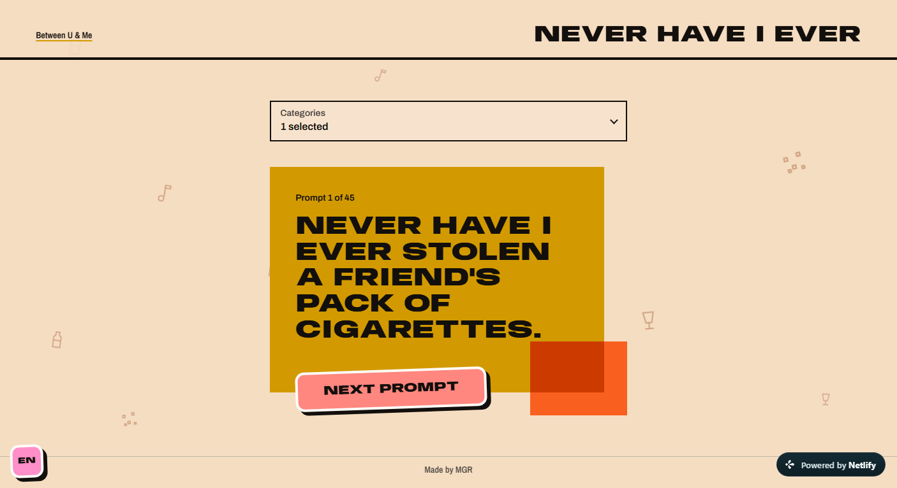
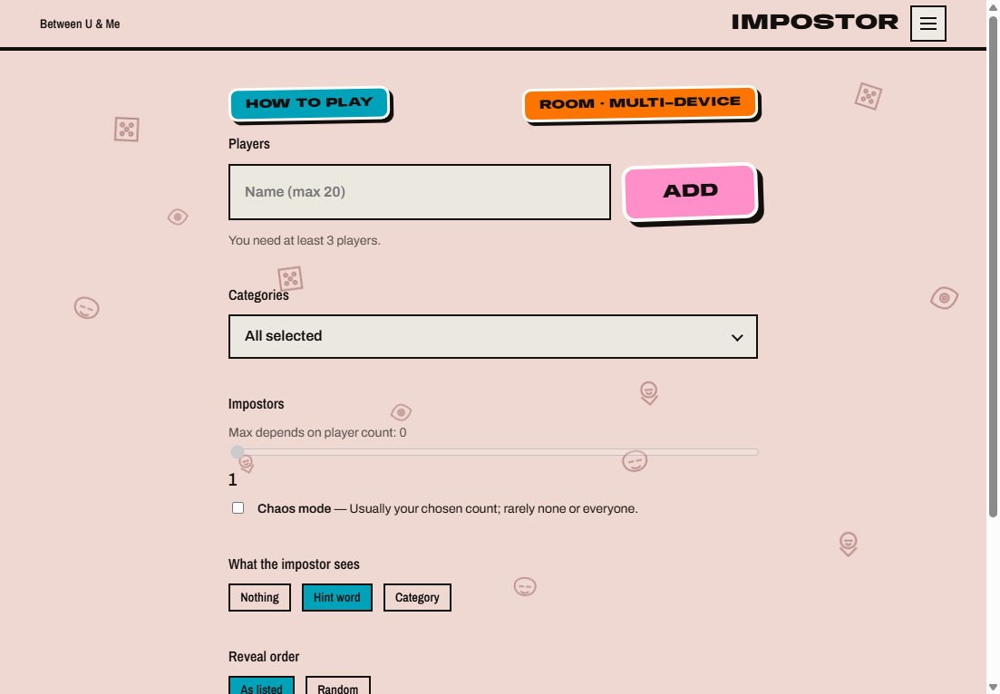
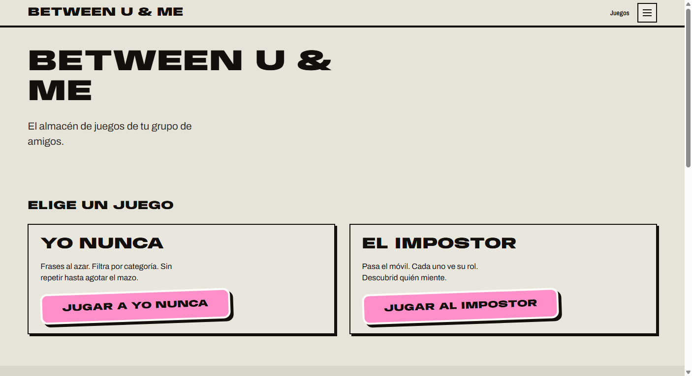

# Between U & Me

<p align="left">
  
  
  
  
  
  
</p>

**Live app:** [https://between-u-and-me.netlify.app](https://between-u-and-me.netlify.app)  
**API:** [https://i-aint-ur-fan.onrender.com](https://i-aint-ur-fan.onrender.com) · health: [`/api/health`](https://i-aint-ur-fan.onrender.com/api/health)

[English](#english) · [Español](#espanol)

---

<a id="english"></a>

## English

**Public web app** | **Party games for friends** | **No login · Rooms via Render**

Between U & Me is a small vault of games for your friend group. Games today:

- **Never Have I Ever** / **Yo Nunca** — random prompts; local or multi-phone room (same phrase synced).
- **The Impostor** — pass-the-phone or room mode with seat claims per device.
- **Who Am I** / **Quién soy** — characters to guess with yes/no questions; local or room.

Language (ES ↔ EN) lives in the **settings menu (☰)** in the header.

### Screenshots






### What you get

- Two separate games from the home catalog
- Header settings menu: language, game shortcuts, help, about
- NHIE: JSON prompt banks, multi-category filters, per-category atmosphere
- Impostor: player names, fixed impostor table, chaos mode, discreet cards, hold-to-flip reveal
- Static hosting friendly (Netlify SPA redirects)

### Tech stack

- **Angular 22** — standalone components
- **TypeScript 5** — app language
- **CSS tokens** — Overprint + Sticker
- **Vitest** — unit tests (deck / deal logic)
- **Static JSON** — `frontend/public/data/`
- **Netlify** — static hosting + SPA redirects

### Run locally

```bash
# API (rooms) — terminal 1
cd backend
npm install
npm run dev
# → http://localhost:3000  health: /api/health

# UI — terminal 2
cd frontend
npm install
npm start
# → http://localhost:4200
```

Set `frontend/src/environments/environment.ts` `apiUrl` if the API is not on `:3000`.

### Scripts

**Frontend** (`frontend/`):

```bash
npm start      # Dev server → http://localhost:4200
npm run build  # Production build
npm test       # Unit tests
```

**Backend** (`backend/`):

```bash
npm run dev    # tsx watch
npm run build  # tsc + copy data
npm start      # node dist/index.js
```

More detail: [frontend/README.md](frontend/README.md)

### Project structure

```text
Between-u-and-me/
├── backend/                 # Express + Socket.IO (rooms)
│   ├── Dockerfile
│   ├── data/                # word / character banks for the API
│   └── src/
├── docs/screenshots/
├── frontend/
│   ├── public/data/         # client JSON banks
│   └── src/app/
│         ├── core/i18n/ room/
│         ├── pages/ home/ neverHaveIEver/ impostor/ whoAmI/ room/
│         └── shared/site-menu/
├── LICENSE
└── README.md
```

### Deploy on Netlify (UI)

| Setting | Value |
|---------|--------|
| Base directory | `frontend` |
| Build command | `npm run build` |
| Publish directory | `dist/between-u-and-me/browser` |

SPA fallback: `/*` → `/index.html` (`200`). Ships `frontend/public/_redirects`.

Point production `environment.prod.ts` `apiUrl` at your Render URL.

### Deploy on Render (API / rooms)

| Setting | Value |
|---------|--------|
| Language | Docker |
| Root Directory | `backend` |
| Dockerfile Path | `Dockerfile` |
| Branch | `main` |
| Health check | `/api/health` |

Environment variables:

- `CORS_ORIGIN` = `https://between-u-and-me.netlify.app` (comma-separate extra origins if needed)
- `PORT` — set by Render

Free instances sleep when idle; the lobby shows a “waking server” hint.

### License

MIT License. See [LICENSE](LICENSE).

---

<a id="espanol"></a>

## Español

**Aplicación web pública** | **Juegos para tu grupo de amigos** | **Sin login · Sin base de datos**

Between U & Me es un almacén pequeño de juegos. Ahora mismo:

- **Yo Nunca** / **Never Have I Ever** — frases al azar, filtros por categoría, sin repetir hasta agotar el mazo.
- **El Impostor** — pasar el móvil: los civiles ven la palabra; el impostor ve pista, categoría o nada.

El idioma (ES ↔ EN) se cambia en el **menú de ajustes (☰)** del header.

### Capturas




### Qué incluye

- Catálogo: Yo Nunca, Impostor, Quién soy + salas multi-móvil
- Menú ☰: idioma, juegos, salas, créditos
- Salas con API Socket.IO (Render): NHIE sincroniza frase; Impostor/Quién soy con claim por móvil
- Modo local pass-the-phone sigue disponible

### Tecnologías

- **Angular 22** + **Express / Socket.IO**
- **JSON** de contenido + salas en memoria en el API
- **Netlify** (UI) + **Render** (API Docker)

### Ejecutar en local

```bash
cd backend && npm install && npm run dev
cd frontend && npm install && npm start
```

UI: [http://localhost:4200](http://localhost:4200) · API: [http://localhost:3000/api/health](http://localhost:3000/api/health)

### Desplegar

- **Netlify:** base `frontend`, build `npm run build`, publish `dist/between-u-and-me/browser`; `apiUrl` de producción → URL Render.
- **Render:** Docker, Root `backend`, Dockerfile `Dockerfile`, health `/api/health`, env `CORS_ORIGIN`.

### Licencia

Licencia MIT. Consulta [LICENSE](LICENSE).
