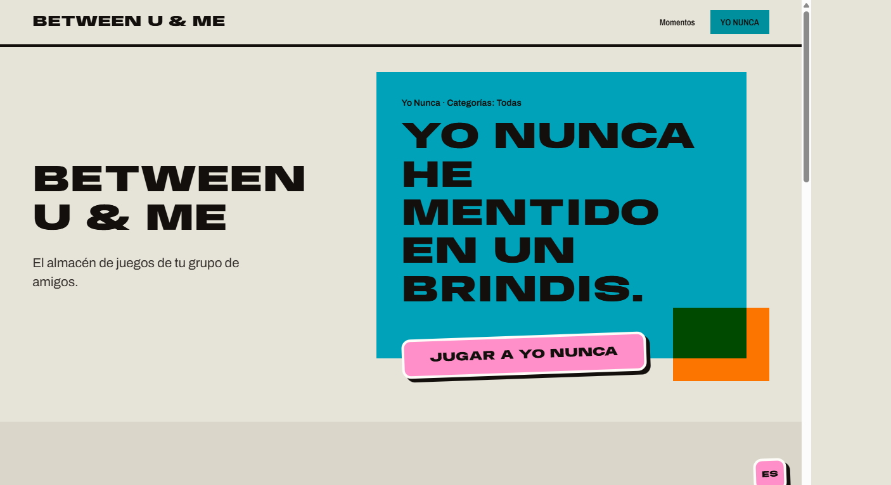
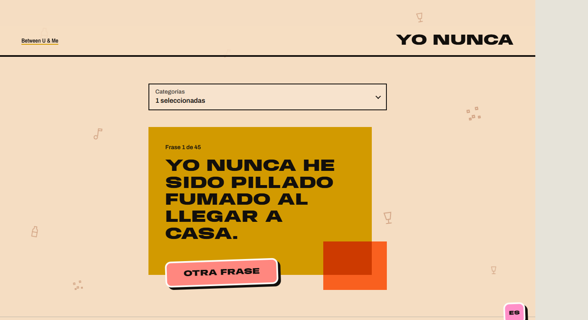

# Between U & Me

<p align="left">
  
  
  
  
  
  
</p>

**Live app:** [https://between-u-and-me.netlify.app](https://between-u-and-me.netlify.app)

[English](#english) · [Español](#espanol)

---

<a id="english"></a>

## English

**Public web app** | **Party games for friends** | **No login · No database**

Between U & Me is a small vault of games for your friend group. The first game is **Never Have I Ever** / **Yo Nunca**.

> Read it out loud. Everyone answers. Keep going until the deck is spent.

The UI switches between **Spanish** and **English**. Prompt banks follow the selected language.

### Screenshots






### What you get

- Random prompts from a JSON bank
- Filter by one or more categories (or all)
- No repeats until the filtered deck is empty, then it reshuffles
- Language bubble (bottom-left) for **ES ↔ EN**
- Look per category: paper tint, floating icons, card colour, overprint pass, and sticker CTA

### Design

**Overprint + Sticker** — newsprint feel, wide display type (Anybody), accent×second-pass multiply (moss where they overlap), die-cut CTA that hangs off the card. In Yo Nunca, each category swaps the palette and the floating line icons.

### Tech stack

- **Angular 22** — standalone components
- **TypeScript 5** — app language
- **CSS tokens** — shared design system (Overprint + Sticker)
- **Vitest** — unit tests (deck logic)
- **Static JSON** — prompt banks in `frontend/public/data/`
- **Node.js 20+** — install, serve, and build
- **Netlify** — static hosting + SPA redirects

### Run locally

```bash
cd frontend
npm install
npm start
```

UI: [http://localhost:4200](http://localhost:4200)

### How to play

1. Open the home page
2. Tap **Yo Nunca** / **Never Have I Ever**
3. Pick one or more categories, or **All**
4. Read the prompt and press **Otra frase** / **Next prompt**
5. Use the language bubble (bottom-left) for **ES ↔ EN**

English loads `nhie.json`. Spanish loads `yo-nunca.json`.

### Scripts

```bash
npm start      # Dev server → http://localhost:4200
npm run build  # Production build
npm test       # Unit tests
```

More detail: [frontend/README.md](frontend/README.md)

### Project structure

```text
Between-u-and-me/
├── docs/
│   └── screenshots/
│         ├── home.png
│         ├── nhie-fiesta.png
│         └── nhie-redes.png
├── frontend/
│   ├── public/
│   │   ├── _redirects
│   │   └── data/
│   │         ├── yo-nunca.json
│   │         └── nhie.json
│   └── src/app/
│         ├── core/i18n/
│         ├── pages/
│         │   ├── home/
│         │   └── neverHaveIEver/
│         └── shared/
│               ├── footer/
│               └── language-bubble/
├── LICENSE
├── README.md
└── .gitignore
```

### Deploy on Netlify

| Setting | Value |
|---------|--------|
| Base directory | `frontend` |
| Build command | `npm run build` |
| Publish directory | `dist/between-u-and-me/browser` |

SPA fallback for routes like `/nhie`: `/*` → `/index.html` (`200`). The repo ships `frontend/public/_redirects` for Netlify.

### License

MIT License. See [LICENSE](LICENSE).

---

<a id="espanol"></a>

## Español

**Aplicación web pública** | **Juegos para tu grupo de amigos** | **Sin login · Sin base de datos**

Between U & Me es un almacén pequeño de juegos para tu grupo. El primero es **Yo Nunca** / **Never Have I Ever**.

> Lee en voz alta. Cada uno responde. Sigue hasta agotar el mazo.

La interfaz se puede cambiar entre **español** e **inglés**. El banco de frases sigue el idioma elegido.

### Capturas


### Qué incluye

- Frases aleatorias desde un banco JSON
- Filtro por una o varias categorías (o todas)
- Sin repeticiones hasta agotar el mazo filtrado; después se baraja de nuevo
- Burbuja de idioma (abajo a la izquierda) para **ES ↔ EN**
- Aspecto por categoría: tinte de fondo, iconos flotantes, color de la carta, pass de overprint y CTA sticker

### Diseño

**Overprint + Sticker** — aire de imprenta, tipografía ancha (Anybody), acento×segundo pass en multiply (moss donde se cruzan), CTA die-cut que sobresale de la carta. En Yo Nunca, cada categoría cambia la paleta y los iconos del fondo.

### Tecnologías

- **Angular 22** — componentes standalone
- **TypeScript 5** — lenguaje de la app
- **Tokens CSS** — sistema de diseño compartido (Overprint + Sticker)
- **Vitest** — tests unitarios (lógica del mazo)
- **JSON estático** — bancos de frases en `frontend/public/data/`
- **Node.js 20+** — instalar, servir y construir
- **Netlify** — hosting estático + redirects SPA

### Ejecutar en local

```bash
cd frontend
npm install
npm start
```

Interfaz: [http://localhost:4200](http://localhost:4200)

### Cómo se juega

1. Entra en la home
2. Pulsa **Yo Nunca**
3. Elige una o varias categorías, o **Todas**
4. Lee la frase y pulsa **Otra frase**
5. Usa la burbuja de idioma (abajo a la izquierda) para **ES ↔ EN**

Con inglés se carga `nhie.json`. Con español, `yo-nunca.json`.

### Scripts

```bash
npm start      # Servidor de desarrollo → http://localhost:4200
npm run build  # Build de producción
npm test       # Tests unitarios
```

Más detalle: [frontend/README.md](frontend/README.md)

### Estructura del proyecto

```text
Between-u-and-me/
├── docs/
│   └── screenshots/
│         ├── home.png
│         ├── nhie-fiesta.png
│         └── nhie-redes.png
├── frontend/
│   ├── public/
│   │   ├── _redirects
│   │   └── data/
│   │         ├── yo-nunca.json
│   │         └── nhie.json
│   └── src/app/
│         ├── core/i18n/
│         ├── pages/
│         │   ├── home/
│         │   └── neverHaveIEver/
│         └── shared/
│               ├── footer/
│               └── language-bubble/
├── LICENSE
├── README.md
└── .gitignore
```

### Desplegar en Netlify

| Ajuste | Valor |
|--------|--------|
| Base directory | `frontend` |
| Build command | `npm run build` |
| Publish directory | `dist/between-u-and-me/browser` |

Fallback SPA para rutas como `/nhie`: `/*` → `/index.html` (`200`). El repo incluye `frontend/public/_redirects` para Netlify.

### Licencia

Licencia MIT. Consulta [LICENSE](LICENSE).
