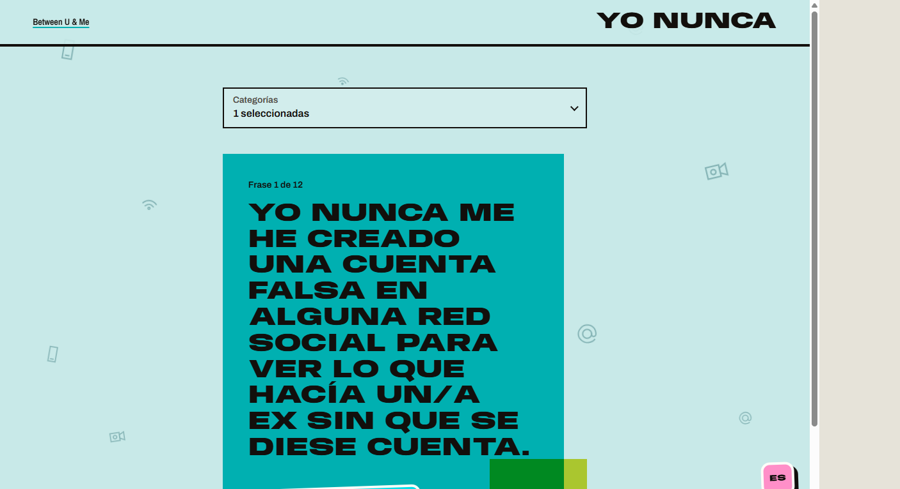

# Between U & Me

[](https://angular.dev/)
[](https://www.typescriptlang.org/)
[](https://nodejs.org/)
[](https://vitest.dev/)
[](./LICENSE)
[](https://www.netlify.com/)

Friends’ game vault — play party games together. First game: **Never Have I Ever** / **Yo Nunca**.

**Live app:** [https://between-u-and-me.netlify.app](https://between-u-and-me.netlify.app)  
**API:** [https://i-aint-ur-fan.onrender.com](https://i-aint-ur-fan.onrender.com) · health: [`/api/health`](https://i-aint-ur-fan.onrender.com/api/health)


---

## English

### What it is

A small web app to store and play games with your friend group. The first game is **Never Have I Ever**, with:

- Random prompts from a JSON bank
- One or more category filters (or all categories)
- No repeats until every prompt in the current filter has been shown, then the deck reshuffles
- Spanish / English UI and prompt packs
- Per-category look: paper tint, floating icons, card colour, overprint pass, and CTA sticker

### Design

**Overprint + Sticker** — newsprint feel, wide display type (Anybody), teal×orange multiply (moss where they overlap), die-cut pink CTA that hangs off the card. In Yo Nunca, each category swaps the palette and the floating line icons.

| Category vibe | Example |
|---------------|---------|
| Party | Amber card, floating bottles / notes |
| Social / tech | Cyan card, phones / @ / signal |
| (and the rest) | Each bank category has its own paper + accents |




### Tech stack

| Area | Choice |
|------|--------|
| Framework | Angular 22 (standalone components) |
| Language | TypeScript |
| Styling | CSS with shared design tokens |
| Tests | Vitest |
| Data | Static JSON prompt banks |
| Hosting | Static build (Netlify-ready) |

### Requirements

- **Node.js** 20 or newer
- **npm** 10 or newer

### Project structure

```text
Between-u-and-me/
├── docs/screenshots/              # README captures
├── frontend/                      # Angular app
│   ├── public/data/
│   │   ├── yo-nunca.json          # Spanish prompts
│   │   └── nhie.json              # English prompts
│   └── src/app/
│       ├── core/i18n/             # Locale + UI strings
│       ├── pages/
│       │   ├── home/              # Landing
│       │   └── neverHaveIEver/    # Game, deck, category atmosphere
│       └── shared/
│           ├── footer/
│           └── language-bubble/   # ES/EN switcher
├── LICENSE
└── README.md
```

### How to run locally

```bash
cd frontend
npm install
npm start
```

Open [http://localhost:4200](http://localhost:4200).

### How to play

1. Open the home page — **Between U & Me**
2. Click **Never Have I Ever** / **Yo Nunca**
3. Select one or more categories, or **All**
4. Read the prompt and press **Next prompt** / **Otra frase**
5. Use the language bubble (bottom-right) to switch **ES ↔ EN**

When English is selected, prompts load from `nhie.json`. When Spanish is selected, they load from `yo-nunca.json`.

### Scripts

```bash
npm start      # Dev server (http://localhost:4200)
npm run build  # Production build
npm test       # Unit tests
```

### Deploy on Netlify

| Setting | Value |
|---------|--------|
| Base directory | `frontend` |
| Build command | `npm run build` |
| Publish directory | `dist/between-u-and-me/browser` |

For Angular client routes such as `/nhie`, configure an SPA fallback so refreshes do not 404 (`/*` → `/index.html` with status `200`). The repo already ships `frontend/public/_redirects` for Netlify.

---

## Español

### Qué es

Una web pequeña para guardar y jugar juegos con tu grupo de amigos. El primero es **Yo Nunca**, con:

- Frases aleatorias desde un banco JSON
- Filtro por una o varias categorías (o todas)
- Sin repeticiones hasta agotar las frases del filtro; después se baraja de nuevo
- Interfaz y frases en español e inglés
- Aspecto por categoría: tinte de fondo, iconos flotantes, color de la carta, pass de overprint y botón sticker

### Diseño

**Overprint + Sticker** — aire de imprenta, tipografía ancha (Anybody), teal×naranja en multiply (moss donde se cruzan), CTA die-cut que sobresale de la carta. En Yo Nunca, cada categoría cambia la paleta y los iconos del fondo.


### Tecnologías

| Área | Elección |
|------|----------|
| Framework | Angular 22 (componentes standalone) |
| Lenguaje | TypeScript |
| Estilos | CSS con tokens de diseño compartidos |
| Tests | Vitest |
| Datos | Bancos JSON estáticos |
| Hosting | Build estático (listo para Netlify) |

### Requisitos

- **Node.js** 20 o superior
- **npm** 10 o superior

### Estructura del proyecto

```text
Between-u-and-me/
├── docs/screenshots/              # Capturas del README
├── frontend/                      # App Angular
│   ├── public/data/
│   │   ├── yo-nunca.json          # Frases en español
│   │   └── nhie.json              # Frases en inglés
│   └── src/app/
│       ├── core/i18n/             # Idioma + textos de UI
│       ├── pages/
│       │   ├── home/              # Portada
│       │   └── neverHaveIEver/    # Juego, mazo, atmósfera por categoría
│       └── shared/
│           ├── footer/
│           └── language-bubble/   # Selector ES/EN
├── LICENSE
└── README.md
```

### Cómo ejecutarlo en local

```bash
cd frontend
npm install
npm start
```

Abre [http://localhost:4200](http://localhost:4200).

### Cómo se juega

1. Entra en la home — **Between U & Me**
2. Pulsa **Yo Nunca**
3. Elige una o varias categorías, o **Todas**
4. Lee la frase y pulsa **Otra frase**
5. Usa la burbuja de idioma (abajo a la derecha) para cambiar **ES ↔ EN**

Con inglés seleccionado se cargan las frases de `nhie.json`. Con español, las de `yo-nunca.json`.

### Scripts

```bash
npm start      # Servidor de desarrollo
npm run build  # Build de producción
npm test       # Tests unitarios
```

### Deploy en Netlify

| Ajuste | Valor |
|--------|--------|
| Base directory | `frontend` |
| Build command | `npm run build` |
| Publish directory | `dist/between-u-and-me/browser` |

Para rutas de Angular como `/nhie`, configura un fallback SPA para que al refrescar no dé 404 (`/*` → `/index.html` con estado `200`). El repo incluye `frontend/public/_redirects` para Netlify.

---

## License

MIT — see [LICENSE](./LICENSE).
