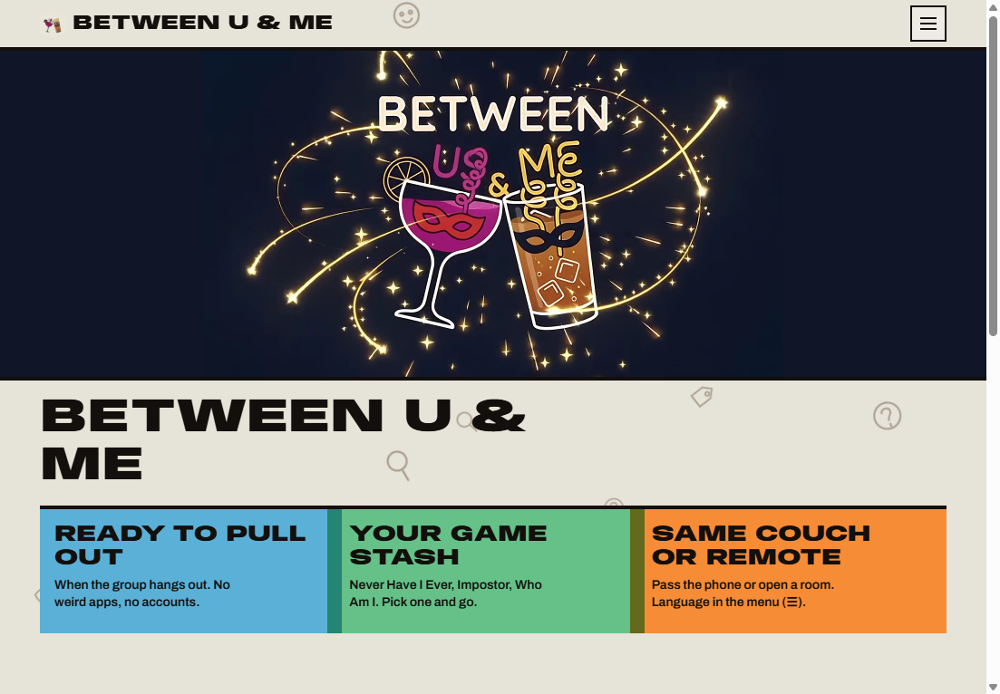
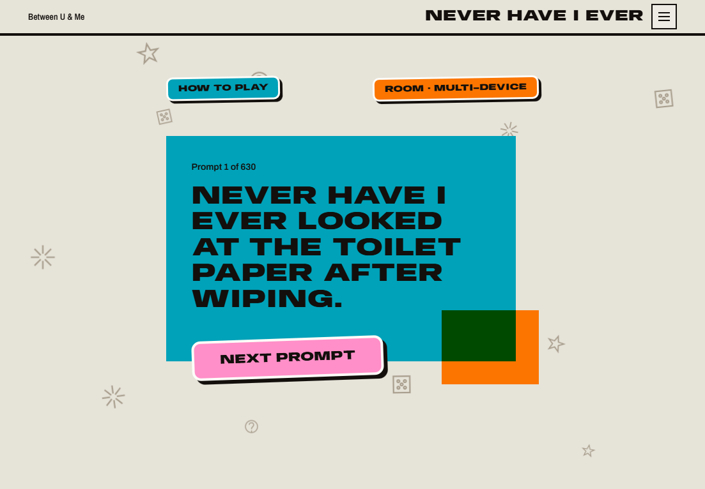
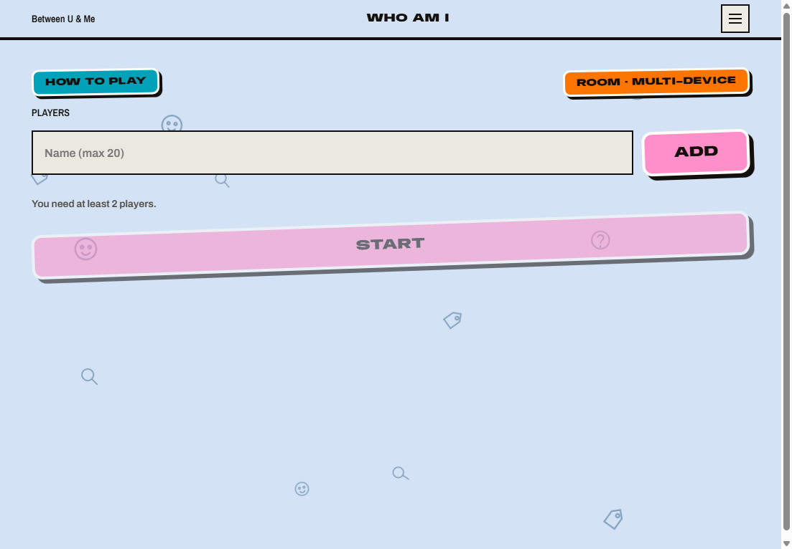
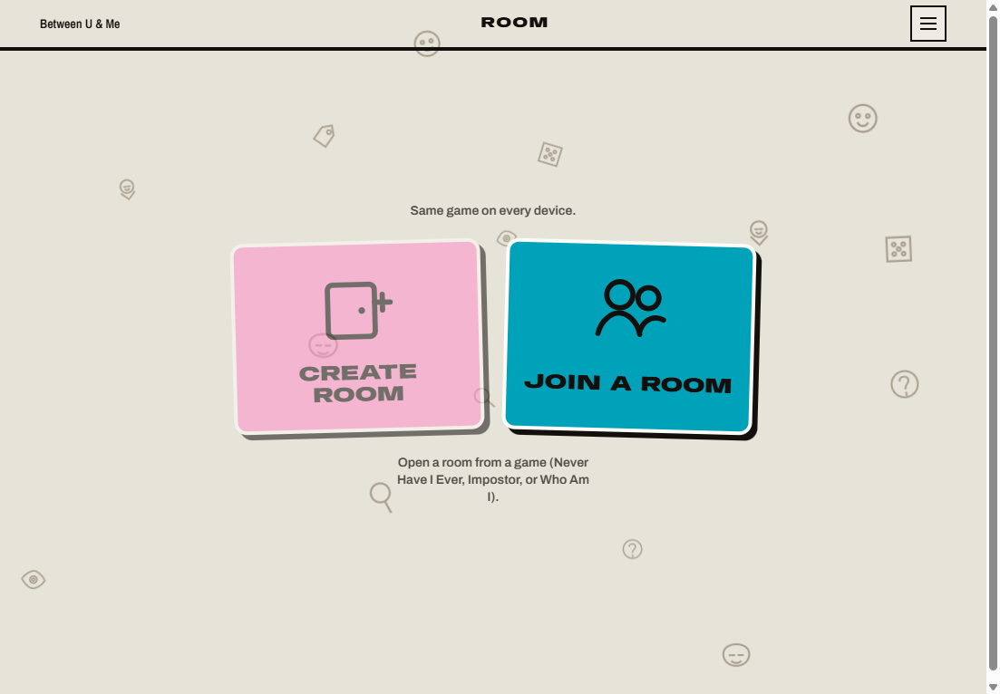
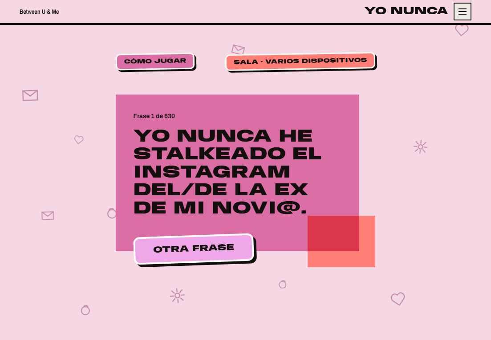
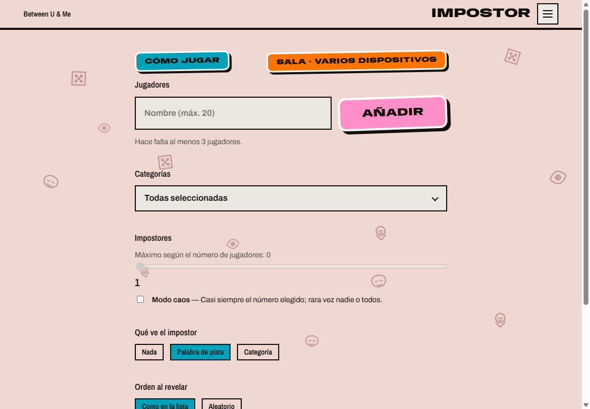
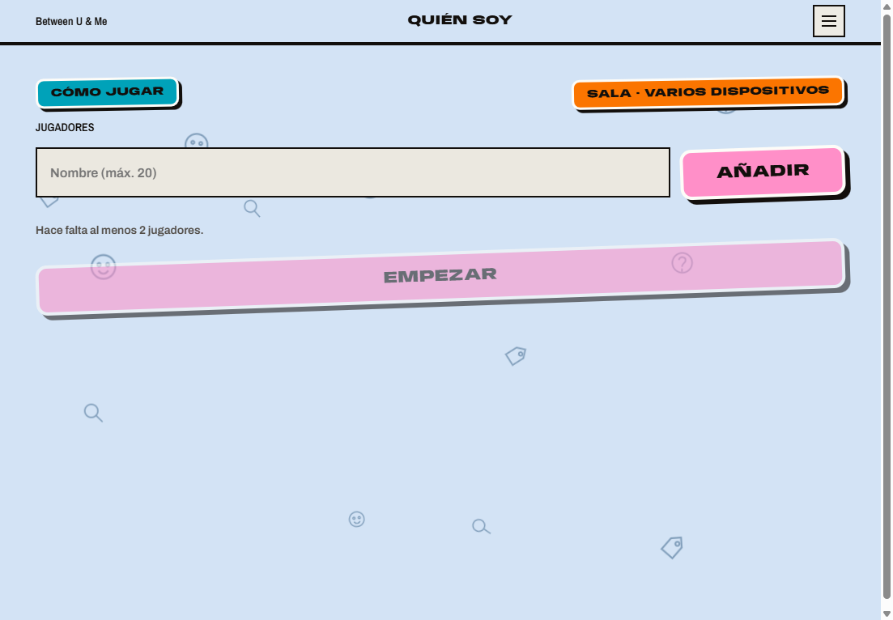
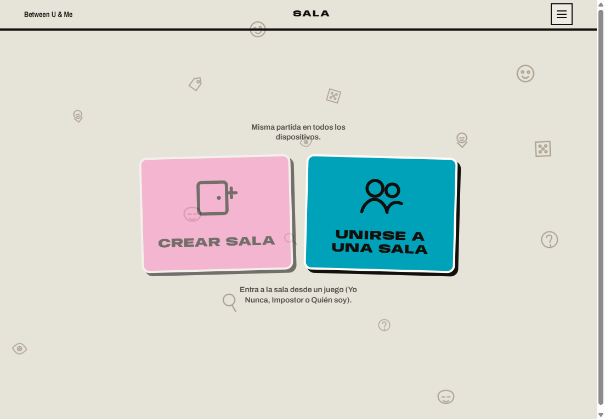

# Between U & Me

<p align="left">
  
  
  
  
  
  
  
</p>

**Live app:** [https://between-u-and-me.netlify.app](https://between-u-and-me.netlify.app)  
**API (rooms):** [https://between-u-and-me.onrender.com](https://between-u-and-me.onrender.com) · health: [`/api/health`](https://between-u-and-me.onrender.com/api/health)

[English](#english) · [Español](#espanol)

---

<a id="english"></a>

## English

**Public web app** | **Party games for friends** | **No login · Rooms via Render**

Between U & Me is a small game stash for your friend group. Games today:

- **Never Have I Ever** / **Yo Nunca** — random prompts; local or multi-device room (same phrase synced).
- **Impostor** — pass-the-phone or room mode with seat claims per device.
- **Who Am I** / **Quién soy** — characters to guess with yes/no questions; portraits when available; local or room.

Language (ES ↔ EN) lives in the **settings menu (☰)** in the header. Each game has **Room · multi-device** (create / join). Leaving a room asks for double confirmation.

### Screenshots










### What you get

- Home: brand toast, three color cards, then pick a game
- Floating print-style atmospheres (per game / NHIE by category)
- Per-game multi-device rooms (create or join with a code)
- Header settings menu: language, game shortcuts, credits
- NHIE: JSON prompt banks; room syncs the same phrase
- Impostor: players, categories, chaos, discreet cards, hold-to-flip reveal (local + room setup)
- Who Am I: character bank + Wikipedia portraits when possible
- Static UI on Netlify + rooms API on Render (Docker)

### Tech stack

- **Angular 22** — standalone components
- **TypeScript 5** — app language
- **Express + Socket.IO** — in-memory rooms (device-stable claims)
- **CSS tokens** — Overprint + Sticker
- **Vitest** — unit tests (deck / deal logic)
- **Static JSON** — `frontend/public/data/` (+ mirrored banks under `backend/data/`)
- **Netlify** — UI · **Render** — API

### Run locally

```bash
# API (rooms) — terminal 1
cd backend
npm install
npm run dev
# → http://localhost:3000  health: /api/health

# UI — terminal 2
cd frontend
npm install
npm start
# → http://localhost:4200
```

Dev `apiUrl` defaults to `http://localhost:3000` in `frontend/src/environments/environment.ts`.

### Scripts

**Frontend** (`frontend/`):

```bash
npm start      # Dev server → http://localhost:4200
npm run build  # Production build
npm test       # Unit tests
```

**Backend** (`backend/`):

```bash
npm run dev    # tsx watch
npm run build  # tsc + copy data
npm start      # node dist/index.js
```

More detail: [frontend/README.md](frontend/README.md)

### Project structure

```text
Between-u-and-me/
├── AGENTS.md                # short map for AI agents
├── .cursor/rules/           # Cursor project rules
├── backend/                 # Express + Socket.IO (rooms)
│   ├── Dockerfile
│   ├── data/                # word / character banks for the API
│   └── src/
├── docs/screenshots/
├── frontend/
│   ├── public/brand/        # logo + toast video
│   ├── public/data/         # client JSON banks
│   └── src/app/
│         ├── core/i18n/ room/ whoami/
│         ├── pages/ home/ neverHaveIEver/ impostor/ whoAmI/ room/
│         └── shared/ site-menu/ game-atmosphere/ whoami-portrait/
├── LICENSE
└── README.md
```

### Deploy on Netlify (UI)

| Setting | Value |
|---------|--------|
| Base directory | `frontend` |
| Build command | `npm run build` |
| Publish directory | `dist/between-u-and-me/browser` |

SPA fallback: `/*` → `/index.html` (`200`). Ships `frontend/public/_redirects`.

Production `apiUrl` is set in `frontend/src/environments/environment.prod.ts` to  
`https://between-u-and-me.onrender.com`.

### Deploy on Render (API / rooms)

| Setting | Value |
|---------|--------|
| Language | Docker |
| Root Directory | `backend` |
| Dockerfile Path | `Dockerfile` (or `backend/Dockerfile` if Root is empty) |
| Docker Build Context | `backend` (if Root is empty) |
| Branch | `main` |
| Health check | `/api/health` |

Environment variables:

- `CORS_ORIGIN` = `https://between-u-and-me.netlify.app` (add `http://localhost:4200` if you test prod API from local UI)
- `PORT` — set by Render

Free instances sleep when idle; the room lobby shows a connecting / waking hint. First request after sleep can take a few seconds.

### License

MIT License. See [LICENSE](LICENSE).

---

<a id="espanol"></a>

## Español

**Aplicación web pública** | **Juegos para tu grupo de amigos** | **Sin login · Salas en Render**

Between U & Me es un almacén pequeño de juegos. Ahora mismo:

- **Yo Nunca** / **Never Have I Ever** — frases al azar; local o sala multi-dispositivo (misma frase).
- **Impostor** — pasar el móvil o sala con claim de asientos por dispositivo.
- **Quién soy** / **Who Am I** — personajes; ves ajenos y adivinas el tuyo; fotos cuando hay; local o sala.

El idioma (ES ↔ EN) se cambia en el **menú de ajustes (☰)**. En cada juego hay **Sala · varios dispositivos** (crear o unirse). Salir de una sala pide doble confirmación.

### Capturas










### Qué incluye

- Portada con brindis, cajitas de color y catálogo de juegos
- Atmósferas con iconos flotantes (por juego / por categoría en Yo Nunca)
- Salas por juego (crear / unirse con código) vía Socket.IO
- Menú ☰: idioma, juegos, créditos
- Impostor en sala con el mismo tipo de ajustes que en local
- Modo local pass-the-phone sigue disponible

### Tecnologías

- **Angular 22** + **Express / Socket.IO**
- **JSON** de contenido + salas en memoria en el API
- **Netlify** (UI) + **Render** (API Docker)

### Ejecutar en local

```bash
cd backend && npm install && npm run dev
cd frontend && npm install && npm start
```

UI: [http://localhost:4200](http://localhost:4200) · API: [http://localhost:3000/api/health](http://localhost:3000/api/health)

### Desplegar

- **Netlify:** base `frontend`, build `npm run build`, publish `dist/between-u-and-me/browser`; `apiUrl` de producción → `https://between-u-and-me.onrender.com`.
- **Render:** Docker, Root `backend`, Dockerfile `Dockerfile`, health `/api/health`, env `CORS_ORIGIN=https://between-u-and-me.netlify.app`.

### Licencia

Licencia MIT. Consulta [LICENSE](LICENSE).
